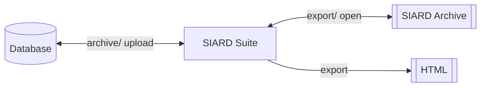
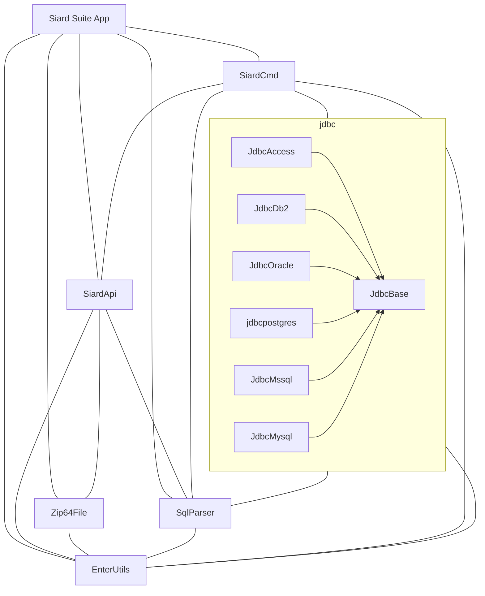

# Software Architecture Documentation

Based on the [arc42](https://arc42.org) template for documentation of software and system architecture, by Dr. Peter Hruschka, Dr. Gernot Starke and contributors.

## Table of Contents
1. [Introduction and Goals](#1-introduction-and-goals)
1. [Constraints](#2-constraints)
1. [Context & Scope](#3-context-and-scope)
1. [Solution Strategy](#4-solution-strategy)
1. [Building Block View](#5-building-block-view)
1. [Runtime View](#6-runtime-view)
1. [Deployment View](#7-deployment-view)
1. [Crosscutting Concepts](#8-crosscutting-concepts)
1. [Architecutural Decisions](#9-architectural-decisions)
1. [Quality Requirements](#10-quality-requirements)
1. [Risks and Technical Debts](#11-risks-and-technical-debts)
1. [Glossary](#12-glossary)

## 1. Introduction and Goals

> _Disclaimer:
This document describes the intended future software architecture of the SIARD Suite after the Migration from JavaFX to a web based user interface. It is not in sync with the current code base! Check the git history to see what changed._

### 1.1. Requirements Overview

SIARD Suite is an application that allows users to archive data from relational databases as SIARD archives and restore data from SIARD archives into relational databases. It also serves as the reference implementation of the [SIARD Specification](https://siard.dilcis.eu/SIARD%202.2/SIARD%202.2.pdf).

| Requirement | Description |
|---|---|
| Exporting and Restoring relational Data | Data from relational databases can be exported as SIARD archives and restored from SIARD archives. |
| Supporting SIARD 2.2 | SIARD Suite supports SIARD 2.2, the latest version of the SIARD specification. |
| Supporting multiple DBMS | Widely used DBMS are supported: MS Access, MS SQL Server, Oracle, PostgreSQL, MySQL, MariaDB, and DB2. |
| Easy of use | The application is easy to use and provides a user-friendly interface. |
| Commnand line tool | A command line tool covers the basic import and export functionality |
| Performance | SIARD Suite must be able to handle large datasets |

### 1.2. Quality Goals

> TODO: review quality goals using https://quality.arc42.org/

| Prio | Goal | Scenario |
| --- | --- | --- |
| 1 | Security | The application must never alter the content of the database when exporting to a SIARD archive. | 
| 2 | Security | Archived data often includes sensitive and must never be leaked. |
| 3 | Performance | SIARD Suite must be able to handle large datasets. |
| 4 | Portability | SIARD Suite and SIARD Cmd run on Linux, Windows, and Mac. |

### 1.3. Stakeholders

> Only stakeholders interested in the documentation are included.

| Role/Name | Contact | Expectations |
|---|---|---|
| Swiss Federal Archives (SFA) | https://github.com/sfa-siard | How can the software run on SFA laptops and workstations given the constraints by the BIT. |
| Developers and Contributors | | Learn about the project structure and how to contribute. |
| Bundesamt für Informatik (BIT) | The BIT packages the application for distrubution on Bundeslaptops. They expect the deliverablas to adhere to their security standards. |

## 2. Constraints

### 2.1. Technical Constraints

| Constraint | Explanation, Background |
|---|---|
| Java | The existing Libraries are written in Java. Porting to a different language is not an option. |
| BIT Guidelines for packages | The BIT has strict guidelines for packages that are distributed to Bundeslaptops. One of them is that no JavaFX libraries can be included. _Important: There might be other constraints that will be revealed during the development process._ |
| Database connections | SIARD Suite must be able to connect to actually connect to a database. This means the application must be in the same network as the database, or it must be possible to establish a connection to the network. |

### 2.2. Organizational Constraints

| Constraint | Explanation, Background |
|---|---|
| Bundeslaptops | Bundeslaptops used by the SFA and other federal agencies are managed by the Bundesamt für Informatik und Telekommunikation (BIT). Users are not allowed to install any software on these machines, except the software is provided by the BIT. |

### 2.3. Conventions

| Constraint | Explanation, Background |
|---|---|
| Modernising Legacy Code | Legacy code uses naming and structure that is not in line with modern Java practices. In general, new code should not follow the conventions of legacy code but use modern style. |
| Coding AIs | The project provides `AGENTS.md` and provides some basic skills. When AI tools meaningfully contribute to a change, this is should be disclosed via a `Co-Authored-By:` or `Assisted-By:` trailer in the commit message. |

## 3. Context and Scope

### 3.1. Business Context

`SIARD Suite` reads data from various database systems in order to create a SIARD Archive file. The application can also read a SIARD Archive and upload it into a database. This is not necessarily the same DBMS as the original data source.

A (somewhat limited) export function allows users to export data from an archive as html files.

Supported Databases are:
- PostgresQL
- MS SQL Server
- Oracle
- MySQL
- MariaDB
- DB2
- MS Access

### 3.2. Technical Context

> TODO

## 4. Solution Strategy

> intentionally left blank for now

## 5. Building Block View

### 5.1. Whitebox Overall System

| Module          | Description                                              |
|-----------------|----------------------------------------------------------|
| Siard Suite App | The current SIARD Suite Desktop Application using JavaFX |
| SiardApi        | Core library for reading and writing SIARD 2.2 archive files. It handles the metadata XML (JAXB) and the table data inside the archive. |
| SiardCmd        | Command-line interface providing `SiardFromDb` (archive a database into SIARD) and `SiardToDb` (restore a SIARD archive into a database). |
| SqlParser       | ANTLR-based SQL parser. Used to analyze and transform SQL statements and datatypes during archiving and restoring. |
| JdbcBase        | Abstract base JDBC wrapper shared by all database-specific driver modules. It also provides common test fixtures. |
| JdbcAccess      | JDBC/ODBC wrapper for reading Microsoft Access databases. |
| JdbcDb2         | JDBC wrapper for IBM DB2 databases. |
| JdbcOracle      | JDBC wrapper for Oracle databases. |
| JdbcMssql       | JDBC wrapper for Microsoft SQL Server databases. |
| JdbcMysql       | JDBC wrapper for MySQL and MariaDB databases. |
| JdbcPostgres    | JDBC wrapper for PostgreSQL databases. |
| SiardUtilities      | Shared utility classes used across the other modules, e.g. for XML handling and progress tracking. |
| Zip64File       | ZIP64 file format handler used to read and write the ZIP container of `.siard` files, including files larger than 4 GB. |

## 6. Runtime View

> intentionally left blank for now

## 7. Deployment View

> intentionally left blank for now

## 8. Crosscutting Concepts

> intentionally left blank for now
 
## 9. Architectural Decisions

> intentionally left blank for now

## 10. Quality Requirements

> intentionally left blank for now

## 11. Risks and Technical Debts

### JDBC wrapper drivers hijack `DriverManager`

The `jdbc-*` modules register their wrapper `Driver` implementations (e.g. `MySqlDriver`) via `META-INF/services/java.sql.Driver`. On registration they deregister the native drivers and intercept every `DriverManager.getConnection("jdbc:mysql:...")` in the JVM. The wrappers rewrite SQL through the ANTLR parser: unquoted identifiers are upper-cased and `sessionVariables=sql_mode='ANSI,...'` is forced. That is intended for the SIARD code paths, but it also affects plain JDBC consumers (tests, testcontainers init scripts).

Example: `INSERT INTO public.all_files` is sent as `INSERT INTO PUBLIC.ALL_FILES`, which fails on case-sensitive MySQL (`INSERT command denied`). Previously this was masked because `mariadb-java-client` 2.x claimed `jdbc:mysql:` URLs first; version 3.x correctly declines when `com.mysql.cj.jdbc.Driver` is present, exposing the wrapper.

Systemic fix: remove the service-loader registration (`META-INF/services/java.sql.Driver`) from the `jdbc-*` modules and let SIARD code load the wrappers explicitly (`SiardConnection.loadValidDriver` already does `Class.forName` + `driver.connect()`), so unrelated `DriverManager` users keep the native drivers. Until then, code that needs a raw connection must bypass `DriverManager` (instantiate the vendor driver directly).

### Deferred Dependency Upgrades

After the dependency cleanup (Oct 2026), the following upgrades were identified but deliberately deferred. See `gradle/libs.versions.toml` in the siard-suite repository for current versions.

| Dependency  | Current                              | Available                          | Effort / Risk                                                                                             |
|-------------|--------------------------------------|------------------------------------|-----------------------------------------------------------------------------------------------------------|
| JavaFX      | 17.0.7                               | 21 / 25                            | Large version jump for `siard-suite-app`; verify UI + jpackage/runtime image                              |
| MaterialFX  | 11.17.0                              | 21.x-alpha only                    | No stable release; keep until one exists                                                                  |
| JTS         | `com.vividsolutions:jts-core` 1.14.0 | `org.locationtech:jts-core` 1.20.0 | Package relocation `com.vividsolutions` -> `org.locationtech`; requires code changes in `siard-utilities` |
| Jackcess    | 2.1.12                               | 4.0.8                              | `jdbc-access` vendors a patched `DatabaseImpl`; port to new API first                                     |
| JAXB        | `javax.xml.bind` 2.3.x               | `jakarta.xml.bind` 4.x             | Namespace migration `javax` -> `jakarta` across `siard-api` + generated code                              |
| json-simple | 1.1.1                                | unmaintained                       | Replace with Jackson/Gson eventually                                                                      |
| Tika        | 3.2.3                                | 4.0.0-alpha only                   | Wait for stable 4.x                                                                                       |

Note: MSV (`msv-core`, `xsdlib`) is intentionally kept — it is loaded reflectively by the JAXB RI's deprecated `Validator` API at runtime (`ValidatingJAXBContext`); it appears unused to static analysis but removing it breaks schema validation (`NoClassDefFoundError`).

## 12. Glossary

| Term | Definition |
|---|---|
| BIT | Bundesamt für Informatik |
| Bundeslaptop | Systems provided to federal employees based on windows with strict security policies |
| SFA | Swiss Federal Archives, Bundesarchiv |
| SIARD | Software Independent Archival of Relational Databases |
