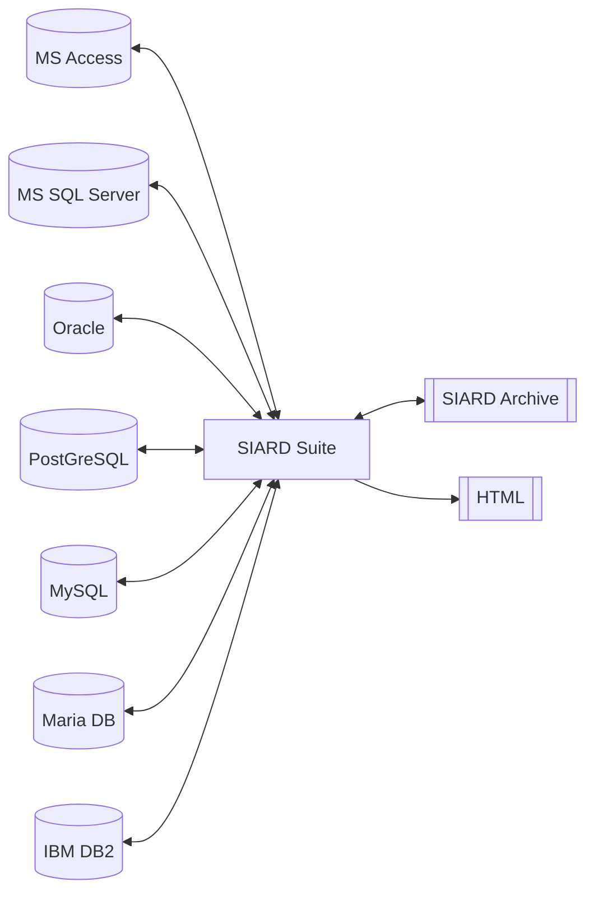
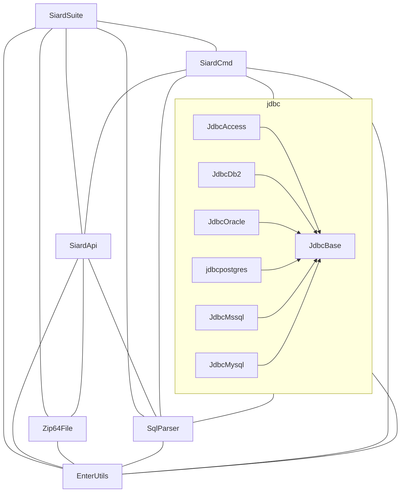

# Software Architecture Documentation

Based on the [arc42](https://arc42.org) template for documentation of software and system architecture, by Dr. Peter Hruschka, Dr. Gernot Starke and contributors.

## 1. Introduction and Goals

### Requirements Overview

SIARD Suite is an application that allows users to archive data from relational databases as SIARD archives and restore data from SIARD archives into relational databases. It also serves as the reference implementation of the [SIARD Specification](https://siard.dilcis.eu/SIARD%202.2/SIARD%202.2.pdf).

| Requirement | Description |
|---|---|
| Exporting and Restoring relational Data | Data from relational databases can be exported as SIARD archives and restored from SIARD archives. |
| Supporting SIARD 2.2 | SIARD Suite supports SIARD 2.2, the latest version of the SIARD specification. |
| Supporting multiple DBMS | Widely used DBMS are supported: MS Access, MS SQL Server, Oracle, PostgreSQL, MySQL, MariaDB, and DB2. |
| Easy of use | The application is easy to use and provides a user-friendly interface. |
| Commnand line tool | A command line tool covers the basic import and export functionality |
| Performance | SIARD Suite must be able to handle large datasets |

### Quality Goals

| Prio | Goal | Scenario |
| --- | --- | --- |
| 1 | Security | The application must never alter the content of the database when exporting to a SIARD archive. | 
| 2 | Security | Archived data often includes sensitive and must never be leaked. |
| 3 | Performance | SIARD Suite must be able to handle large datasets. |
| 4 | Portability | SIARD Suite and SIARD Cmd run on Linux, Windows, and Mac. |

### Stakeholders

| Role/Name | Contact | Expectations |
|---|---|---|
| Swiss Federal Archives (SFA) | https://github.com/sfa-siard | Long-term archiving of datasets. Support for common relational database systems. Reliable, correct archiving of big datasets. The software must run given the constraints on SFA laptops and workstations.Cost-efficient maintenance and flexible software. |
| Archives worldwide | - | Long-term archiving of datasets. Support for common relational database systems. Reliable, correct archiving of big datasets. Quick Issue handling. |
| SIARD Suite users | - | Good User Experience Support for a variety of different DBMS. |
| Puzzle ITC AG (main contributor) | https://github.com/puzzle | |
| Bundesamt für Informatik (BIT) | The BIT packages the application for distrubution among SFA workers. They expect the deliverablas to adhere to their security standards. |
| Developers, contributors | - | Modern Java, clean codebase. Simple setup including a variety of databases with test data. |

## 2. Architecture Constraints

### Technical Constraints

| Constraint | Explanation, Background |
|---|---|
| SFA staff cannot execute downloaded binary files or scripts | Computers (aka Bundeslaptops) used by the SFA are managed by the Bundesamt für Informatik und Telekommunikation (BIT). Users are not allowed to install any software on these machines. |
| No JavaFX available for packaging||

## 3. System Scope and Context

### Business Context

The Application `SIARD Suite` is able to read data from various database systems in order to create a SIARD Archive file. The application can also read a SIARD Archive and upload it into a database. This is not necessarily the same DBMS as the original data source.

A (somewhat limited) export function allows users to export data from an archive as html files.

### Technical Context

SIARD Suite is a standalone Java Application that runs on Linux, Windows, and Mac. The connection to the databases is done using vendor-specific JDBC drivers using a jdbc url.

## 4. Building Block View

### Whitebox Overall System

### Contained Building Blocks

| Module | Repository |
|---|---|
| SiardSuite | https://github.com/sfa-siard/siard-suite |
| SiardApi | https://github.com/sfa-siard/SiardApi |
| SiardCmd | https://github.com/sfa-siard/SiardCmd |
| SqlParser | https://github.com/sfa-siard/SqlParser |
| JdbcBase | https://github.com/sfa-siard/JdbcBase |
| JdbcAccess | https://github.com/sfa-siard/JdbcAccess |
| JdbcDb2 | https://github.com/sfa-siard/JdbcDb2 |
| JdbcOracle | https://github.com/sfa-siard/JdbcOracle |
| JdbcMssql | https://github.com/sfa-siard/JdbcMsSql |
| JdbcMysql | https://github.com/sfa-siard/JdbcMySql |
| JdbcPostgres | https://github.com/sfa-siard/JdbcPostgres |
| EnterUtils | https://github.com/sfa-siard/EnterUtilities |
| Zip64File | https://github.com/sfa-siard/Zip64File |

## 5. Risks and Technical Debts

### MaterialFX

For compatibility with Java 8, Siard Suite has been using a MaterialFx dependency that was ported to Java 8: https://github.com/Glavo/MaterialFX-Java8.
Now that SIARD software has been migrated to Java 17, this old dependency can be replaced with the official one: https://github.com/palexdev/MaterialFX. However, there are likely to be some breaking changes and the UI might have to be adapted.

### JDBC wrapper drivers hijack `DriverManager`

The `jdbc-*` modules register their wrapper `Driver` implementations (e.g. `MySqlDriver`) via `META-INF/services/java.sql.Driver`. On registration they deregister the native drivers and intercept every `DriverManager.getConnection("jdbc:mysql:...")` in the JVM. The wrappers rewrite SQL through the ANTLR parser: unquoted identifiers are upper-cased and `sessionVariables=sql_mode='ANSI,...'` is forced. That is intended for the SIARD code paths, but it also affects plain JDBC consumers (tests, testcontainers init scripts).

Example: `INSERT INTO public.all_files` is sent as `INSERT INTO PUBLIC.ALL_FILES`, which fails on case-sensitive MySQL (`INSERT command denied`). Previously this was masked because `mariadb-java-client` 2.x claimed `jdbc:mysql:` URLs first; version 3.x correctly declines when `com.mysql.cj.jdbc.Driver` is present, exposing the wrapper.

Systemic fix: remove the service-loader registration (`META-INF/services/java.sql.Driver`) from the `jdbc-*` modules and let SIARD code load the wrappers explicitly (`SiardConnection.loadValidDriver` already does `Class.forName` + `driver.connect()`), so unrelated `DriverManager` users keep the native drivers. Until then, code that needs a raw connection must bypass `DriverManager` (instantiate the vendor driver directly).

### Deferred Dependency Upgrades

After the dependency cleanup (Oct 2026), the following upgrades were identified but deliberately deferred. See `gradle/libs.versions.toml` in the siard-suite repository for current versions.

| Dependency  | Current                              | Available                          | Effort / Risk                                                                                             |
|-------------|--------------------------------------|------------------------------------|-----------------------------------------------------------------------------------------------------------|
| JavaFX      | 17.0.7                               | 21 / 25                            | Large version jump for `siard-suite-app`; verify UI + jpackage/runtime image                              |
| MaterialFX  | 11.17.0                              | 21.x-alpha only                    | No stable release; keep until one exists                                                                  |
| JTS         | `com.vividsolutions:jts-core` 1.14.0 | `org.locationtech:jts-core` 1.20.0 | Package relocation `com.vividsolutions` -> `org.locationtech`; requires code changes in `siard-utilities` |
| Jackcess    | 2.1.12                               | 4.0.8                              | `jdbc-access` vendors a patched `DatabaseImpl`; port to new API first                                     |
| JAXB        | `javax.xml.bind` 2.3.x               | `jakarta.xml.bind` 4.x             | Namespace migration `javax` -> `jakarta` across `siard-api` + generated code                              |
| json-simple | 1.1.1                                | unmaintained                       | Replace with Jackson/Gson eventually                                                                      |
| Tika        | 3.2.3                                | 4.0.0-alpha only                   | Wait for stable 4.x                                                                                       |

Note: MSV (`msv-core`, `xsdlib`) is intentionally kept — it is loaded reflectively by the JAXB RI's deprecated `Validator` API at runtime (`ValidatingJAXBContext`); it appears unused to static analysis but removing it breaks schema validation (`NoClassDefFoundError`).

## 6. Glossary

| Term | Definition |
|---|---|
| BIT | Bundesamt für Informatik |
| SFA | Swiss Federal Archives, Bundesarchiv |
| SIARD | Software Independent Archival of Relational Databases |
