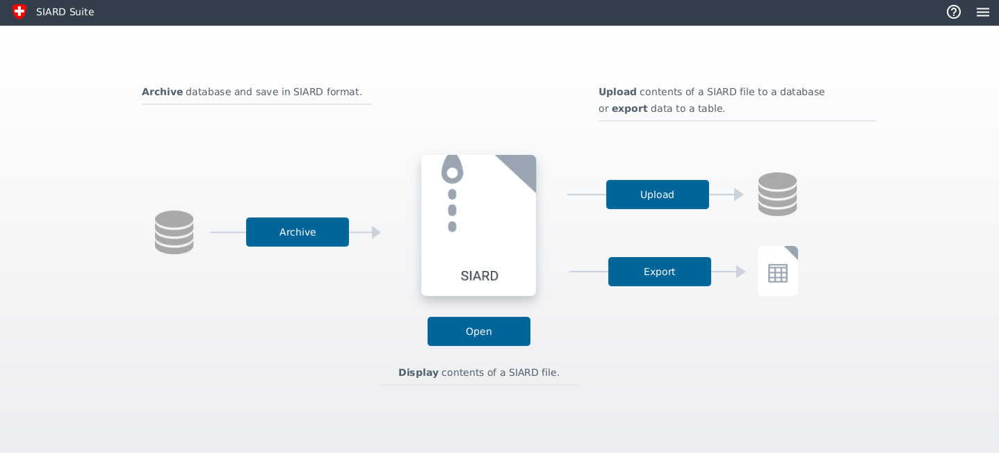
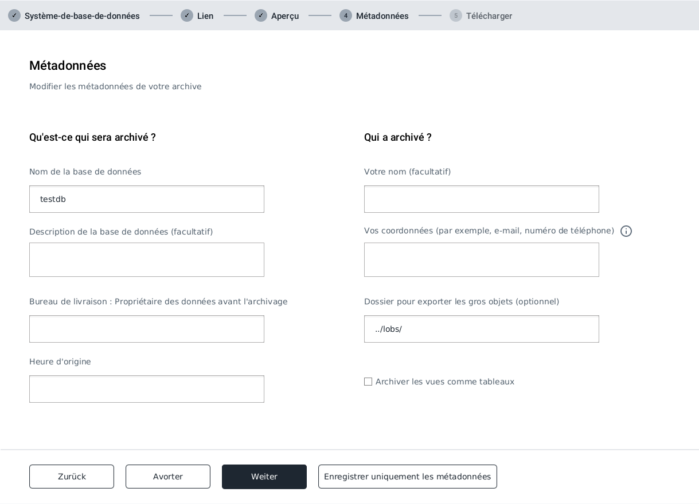
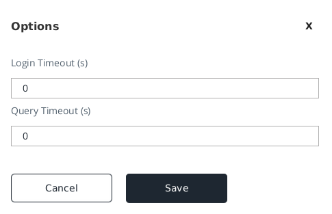

include::../../theme/config.adoc[]
:toc-title: Table des matières
= Siard Suite Manual

== Introduction

La norme SIARD (Software-Independent Archival of Relational Databases) définit un format permettant d'archiver à long terme les contenus de bases de données relationnelles. L'application "SIARD Suite" offre une interface utilisateur graphique permettant d'archiver, de restaurer, de rechercher et d'exporter des archives SIARD.

== Contexte

La version 2.1 du format SIARD a été spécifiée entre 2015 et 2018 en collaboration avec le projet européen E-ARK et le CECO. Comme la version 1.0 auparavant, le format SIARD 2.1 a été homologué en tant que norme eCH-0165 par l'association "eCH E-Government Standards". En 2021, le comité directeur de DILCIS a développé et approuvé le format SIARD élargi 2.2.

SIARD Suite est l'implémentation de référence pour l'archivage de bases de données relationnelles au format standardisé SIARD 2.2. De plus, SIARD Suite peut également lire des archives SIARD aux formats SIARD 2.1 et SIARD 1.0 et les convertir en SIARD 2.2.

== A propos de ce document

Ce document donne un bref aperçu de l'application et de son utilisation. Un manuel détaillé en anglais est disponible dans cette application ainsi que sur le site web du projet des Archives fédérales suisses : https://www.bar.admin.ch/bar/fr/home/archivage/outils-et-instruments/siard-suite.html

== Configuration requise et installation

L'application SIARD Suite est une application Java FX. En tant que telle, elle peut en principe être exécutée sur tout système sur lequel un Java Runtime Environment (JRE) 17 avec l'extension JavaFX est installé.

De plus, des distributions avec JRE inclus ainsi que des installateurs natifs pour Windows, Mac et Linux sont disponibles, de sorte qu'il n'est pas nécessaire d'installer un JRE sur le système.

Les différentes distributions sont présentées ci-dessous. Toutes les distributions peuvent être téléchargées ici : https://github.com/sfa-siard/siard-suite/releases


|===
|Nom de la distribution | Description

|SIARD-Suite-v2.2
|Distribution sans runtime, nécessite JRE installé avec JavaFX sur le système
|SIARD-Suite-v2.2-Linux
|Distribution avec runtime inclus pour Linux
|SIARD-Suite-v2.2-Windows
|Distribution avec runtime inclus pour Windows
|SIARD-Suite-v2.2-macOS
|Distribution avec runtime inclus pour MacOS
|SIARD-Suite-v2.2-Linux-deb
|Installateur natif pour Linux
|SIARD-Suite-v2.2-win-exe
|Installateur natif pour Windows (exe)
|SIARD-Suite-v2.2-win-msi
|Installateur natif pour Windows (msi)
|SIARD-Suite-v2.2-macOS-dmg
|Installateur natif pour MacOS
|===

*Note:* Si l'installateur natif est utilisé, le Siard CLI (Command Line Interface) n'est pas disponible. Pour pouvoir utiliser le CLI, il faut utiliser une distribution avec ou sans JRE inclus.


=== Installation et exécution de l'application

Si les installateurs natifs sont utilisés, l'installation se fait simplement via le système. Les droits d'administrateur sont éventuellement utilisés à cet effet. Les installateurs créent également les raccourcis correspondants pour lancer l'application.

Les distributions avec ou sans JRE inclus sont livrées sous forme d'archives ZIP. Celle-ci peut être décompressée à l'endroit de son choix. L'application peut ensuite être lancée via l'un des scripts de démarrage :

|===
| nom du script | description

| siard-suite (.bat) | Démarrage de l'interface utilisateur graphique pour les systèmes Unix ou Windows
|| siard (.bat) | Ligne de commande : archiver une base de données ou charger une archive SIARD (CLI)
|===


== Utiliser SIARD Suite

La suite SIARD est composée des éléments suivants :

* Interface utilisateur graphique (GUI)
* siard (CLI)

Le but et l'utilisation des composants sont expliqués dans la suite.

=== SIARD Suite GUI

L'interface utilisateur graphique est l'application centrale permettant de créer des archives SIARD et de les consulter ultérieurement, sans que les données primaires de l'archive puissent être modifiées. Pour des analyses complexes des données archivées, l'archive doit être téléchargée à nouveau dans une base de données.

L'écran d'accueil constitue le point d'entrée dans l'application. C'est ici que les quatre fonctionnalités principales de l'application peuvent être initiées :





* Archiver la base de données
* Ouvrir les archives SIARD
* Télécharger une archive SIARD dans une base de données
* Exporter les données d'une archive SIARD.

L'application guide l'utilisateur à travers les processus respectifs.

==== Archivage de bases de données avec Binary Data

La norme SIARD Format 2.2 stipule que les objets volumineux (LOB) d'une base de données peuvent être enregistrés dans le système de fichiers externe.

L'emplacement de stockage des données peut être saisi pendant l'archivage dans l'étape "Métadonnées".



Le chemin peut être indiqué de manière absolue sous forme de File-URI (`file:/`) ou relative, par exemple `../lobs/` - dans tous les cas, le chemin doit être terminé par une barre oblique (`/`). Il est recommandé de spécifier des chemins d'accès relatifs de manière à ce que l'archive puisse être déplacée avec les données LOB externes - ce qui n'est pas possible si des chemins d'accès absolus sont utilisés.
La structure à l'intérieur du dossier spécifié est ensuite générée automatiquement et suit la structure de la base de données : `schema/table/column`. SIARD Suite détecte automatiquement le type MIME et les extensions de fichiers sont automatiquement définies correctement. Cela permet également d'ouvrir les données binaires directement à partir de SIARD Suite dans l'application correcte installée sur le système.

==== Paramètres

L'option de menu "Options" permet de configurer l'application.



Les réglages suivants peuvent être effectués :

|===
| Option | Description

| Login Timeout (s) | Temps d'attente maximal pour une connexion à la base de données (en secondes). 0 pour illimité
| Query Timeout (s) | Temps d'attente maximal pour une requête de base de données (0 pour illimité).
|===

=== SIARD Suite CLI

Outre l'interface utilisateur graphique, les bases de données peuvent également être archivées ou une archive peut être relue dans une base de données via la ligne de commande.

Pour cela, le script `siard` avec les sous-commandes `archive` (archiver une base de données dans un fichier SIARD) et `restore` (charger une archive SIARD dans une base de données) est disponible dans la distribution ZIP. `siard --help`, `siard archive --help` et `siard restore --help` affichent l'aide générée, `siard --version` les informations de version ; le code de sortie est `0` en cas de succès, `1` en cas d'erreur d'exécution et `2` en cas d'erreur d'usage. Le mot de passe de la base de données est déterminé dans cet ordre : `--password=<valeur>`, une invite interactive lorsque `--password` est donné sans valeur, ou la variable d'environnement `SIARD_PASSWORD`.

=== siard archive

Avec `siard archive`, une base de données peut être archivée sans utiliser l'interface utilisateur graphique.

==== Appel

Dans un terminal, allez dans le répertoire où l'archive ZIP a été décompressée, ouvrez-y le répertoire `bin` et exécutez-le avec

```
siard archive --jdbc-url=<JDBC URL> --user=<database user> [--password[=<database password>]] (--siard-file=<siard file> | --export-xml=<export meta data>) [--overwrite] [--views-as-tables] [--login-timeout=<login timeout>] [--query-timeout=<query timeout>] [--import-xml=<import meta data>] [--lob-folder=<external lob folder>] [--mime-type=<mime type>] [--schema=<schema name>]
```

==== Arguments

|===
|Argument | Description

| -o, --overwrite | Écraser le(s) fichier(s) de sortie, s'il(s) existe(nt)
| -v, --views-as-tables | Archiver les vues en tant que tables
| -l, --login-timeout | Timeout en secondes pour la connexion (login) (0 pour illimité)
| -q, --query-timeout | Timeout en secondes pour l'interrogation (0 pour illimité)
| <import meta data> | Nom du fichier XML de métadonnées à utiliser comme modèle
| -x, --lob-folder | Dossier dans lequel les données de la plus grande colonne LOB (large object) de la base de données doivent être enregistrées en externe (les contenus portant le même nom sont écrasés !)
| -m, --mime-type | Type MIME des données de la plus grande colonne LOB de la base de données (influence le choix de l'extension de nom des LOBs stockés en externe)
| --schema | Nom du schéma à archiver
| -j, --jdbc-url | URL JDBC de la base de données qui doit être téléchargée.

Exemples :

*MS Access:* jdbc:access:<path>/<filename>.mdb

*DB/2:* jdbc:<host>:50000/<db-name>

*MySQL:* jdbc:mysql://<host>:3306/<db-name>

*Oracle:*
jdbc:oracle:thin:@<host>:1521:orcl

*Postgres:*
jdbc:postgresql://<host>:5432/<db-name>.

*SQL-Server:*
jdbc:sqlserver://<host>/<db-name>:1433
| -u, --user | Utilisateur de la base de données
| -p, --password | Mot de passe de la base de données
| -s, --siard-file | Nom du fichier .siard à créer
| <export meta data> | Nom du fichier de métadonnées .xml à exporter

|===

==== Remarques

Au moins un des deux paramètres `siard-file` ou `export meta data` doit être activé (il est également possible d'utiliser les deux paramètres).

__Remarque: Pendant le processus d'archivage, le contenu de la base de données ne doit pas être modifié - utilisez si nécessaire un snapshot de la base de données.__

L'option Archiver les vues en tant que tables conduit généralement à un stockage redondant des mêmes données et n'est donc pas recommandée. Elle est utile lorsque l'utilisateur de la base de données utilisé pour l'archivage peut afficher le contenu des vues, mais pas celui des tables de base.

Le processus d'archivage est soit entièrement réussi, soit échoue.

Pour les grandes bases de données, il est recommandé de télécharger d'abord le XML de métadonnées. Celui-ci contient toutes les métadonnées et les tailles des tables et aide ainsi à estimer le temps d'exécution nécessaire pour le téléchargement. En outre, pour les grandes tables, il est conseillé d'utiliser l'option --query-timeout=0, car il est impossible d'estimer le nombre de secondes que prendra une requête de taille.

==== Utilisateur de la base de données

Il n'est généralement pas recommandé d'utiliser l'administrateur de la base de données (DBA, root, dbo, ...) avec tous les droits pour télécharger une archive SIARD. L'étendue des données stockées dans l'archive SIARD est définie par les objets auxquels l'utilisateur de l'archive peut accéder en lecture. Le DBA global peut normalement lire toutes les bases de données du système et, en outre, de nombreuses tables système qui ne doivent pas être archivées. C'est pourquoi il est important d'utiliser un utilisateur d'archives approprié pour le téléchargement, qui doit éventuellement être recréé à cette fin.

=== siard restore

La sous-commande `siard restore` charge une archive SIARD dans une instance de base de données à des fins de recherche.

==== Appel
```shell
siard restore --siard-file=<siard file> --jdbc-url=<JDBC URL> --user=<database user> [--password[=<database password>]] [--overwrite] [--login-timeout=<login timeout>] [--query-timeout=<query timeout>] [--map-schema=<schema>=<mappedschema>]
```

==== Arguments

|===
| Argument | Description

|-o | Écraser (overwrite) les types et/ou les tables de même nom dans la base de données, s'il y en a.
| -l, --login-timeout | Timeout en secondes pour la connexion (login) (0 pour illimité)
| -q, --query-timeout | Timeout en secondes pour une requête (query) (0 pour illimité)
| -s, --siard-file | Nom du fichier .siard à télécharger
| -j, --jdbc-url | URL JDBC de la base de données cible.
Exemples :

*MS Access:* jdbc:access:<path>/<file-name>.mdb

*DB/2:* jdbc:<host>:50000/<db-name>

*MySQL:* jdbc:mysql://<host>:3306/<db-name>

*Oracle:* jdbc:oracle:thin:@<host>:1521:orcl

*Postgres:* jdbc:postgres://<host>:5432/<db-name>

*SQL-Server:* jdbc:sqlserver://<host>\<db-name>:1433
| -u, --user | Utilisateur de la base de données
| -p, --password | Mot de passe de la base de données
| --map-schema=<schema>=<mappedschema> | Correspondance d'un nom de schéma dans l'archive SIARD avec le nom à utiliser dans la base de données (répétable)
|===

==== Remarques

Comme les anciennes bases de données ne sont pas conformes à SQL:2008, il est inévitable que quelques préparations manuelles soient nécessaires pour le téléchargement. Dans MS Access, il n'y a pas d'objets de schéma. Dans Oracle, les utilisateurs et les schémas sont indissociables. Dans MySQL, les objets de schéma et les bases de données sont la même chose. Par conséquent, tous les schémas doivent être créés manuellement avant le téléchargement. En outre, l'utilisateur de la base de données doit avoir le droit de créer des tables et des types dans ces schémas. Comme cela n'est pas toujours facile, les schémas de base de données sont affectés aux noms des schémas conformément à la liste de mappage sur la ligne de commande.

Le téléchargement ne crée que des tables et des types et tente d'activer les clés primaires et étrangères. Aucun autre objet n'est créé dans la base de données cible. Si les clés n'ont pas pu être activées, un avertissement est émis, mais l'upload est tout de même considéré comme terminé avec succès. Les requêtes SQL-SELECT sur la base de données peuvent également être exécutées sans ces clés.

En outre, il peut y avoir des restrictions lors du téléchargement. Avec MS Access, toutes les tables atterrissent dans la même MDB/ACCDB. Chez Oracle, tous les noms de plus de 30 caractères sont raccourcis. Pour éviter les collisions, les noms de tables et de colonnes sont dotés d'un compteur. (Par exemple, "Un nom de table qui est beaucoup trop long pour Oracle" devient "Un nom de table qui Table01").

Si la précision maximale et le nombre maximal de décimales (par ex. sous MS Access) sont inférieurs à ce qui est nécessaire, les valeurs sont téléchargées avec une précision moindre. SIARD se débrouille comme il peut dans le système de base de données cible. Si les métadonnées de la base de données sont consultées avec SiardGui, les désignations et valeurs correctes peuvent être attribuées.

== Conseils et astuces

=== Préparation d'une base de données pour le téléchargement

SIARD Suite télécharge toutes les données visibles par l'utilisateur de base de données utilisé pour la connexion. Le choix d'un utilisateur de base de données approprié détermine donc la taille de la base de données archivée. Souvent, un "utilisateur technique de base de données" approprié est disponible pour une application de base de données avec laquelle la base de données est gérée. En règle générale, cet utilisateur dispose exactement des droits d'accès nécessaires à l'archivage de la base de données.

Toutefois, si un tel utilisateur de base de données n'est pas disponible, il ne faut pas utiliser l'administrateur de la base de données (database administrator, DBA, dbo, root, SYSTEM, sa, ...) pour le téléchargement. En effet, celui-ci a un accès en lecture à de nombreuses tables système et tables d'autres bases de données qui ne doivent pas être archivées. Il est plutôt recommandé de créer un utilisateur de base de données pour l'archivage. Il faut accorder à cet utilisateur d'archivage des droits de lecture sur tous les schémas, tables, vues et types qui appartiennent à la base de données à archiver. Pour savoir comment créer un utilisateur et lui attribuer les privilèges nécessaires, il convient de consulter la documentation du SGBD.

Lorsqu'un utilisateur approprié a été désigné ou créé, le téléchargement de la base de données peut être effectué avec ses données de connexion.

=== Préparation d'une base de données pour l'upload

Pour l'upload d'une base de données dans une instance d'un SGBD avec SIARD Suite, des schémas de base de données appropriés doivent être disponibles dans la base de données cible. Ces schémas peuvent ensuite être affectés aux schémas dans les archives SIARD dans le mappage des schémas de la boîte de dialogue de téléchargement (ou dans le mappage des schémas de de la commande `siard restore`).

Dans le cas idéal, les schémas cibles sont vides. Cependant, selon les paramètres de sécurité du SGBD, il n'est pas toujours possible de créer ou de sélectionner des schémas à volonté. Si les schémas cibles ne sont pas vides, les données archivées ne sont téléchargées que si soit il n'y a pas de collision de noms pour les types et les tables, soit l'option Écraser a été explicitement sélectionnée.

L'utilisateur de la base de données dont les données de connexion sont utilisées pour le téléchargement doit avoir le droit de créer des types et des tables dans les schémas cibles et d'insérer des données dans ces tables. La documentation du SGBD contient des informations sur la manière de créer des schémas et d'accorder les droits nécessaires à l'utilisateur de la base de données. Le plus simple est d'utiliser, si possible, les données d'accès de l'administrateur de la base de données. En effet, celui-ci dispose en général de tous les privilèges nécessaires. Dans ce cas, il ne faut toutefois pas choisir l'option Remplacer. Sinon, le risque est trop grand que des tables ou des types importants soient écrasés dans le système.

=== Heure, horodatage et fuseaux horaires

La conversion des TIMEs et des TIMESTAMPs dans la base de données dépend du fuseau horaire local. L'heure UTC 14:30 dans les archives SIARD est chargée dans la base de données en tant qu'heure locale 15:30 lors du téléchargement à Zurich - en hiver. Pour supprimer cette conversion, `siard restore` doit être démarré avec l'option `-Duser.timezone=GMT`, ce qui fait que SIARD interprète toutes les heures de la base de données comme des heures UTC.

=== Connexions chiffrées

* *Exigences Java 17 :* Pour des raisons de sécurité, les versions récentes de Java ne prennent plus en charge les protocoles obsolètes TLS 1.0 et 1.1 par défaut. TLS 1.2 ou supérieur est requis.
** _Remarque :_ Si TLS 1.0/1.1 est impérativement requis pour des systèmes hérités, il doit être réactivé explicitement dans le fichier `+java.security+` de la JVM.

=== MS SQL Server

* *Pilote JDBC (Chiffrement) :* Depuis la version 10.2 (y compris la 13.4.0), le chiffrement est activé par défaut (`+encrypt=true+`).
* *Vérification du certificat :* Le pilote vérifie désormais rigoureusement si le certificat du serveur est fiable (`+trustServerCertificate=false+`).
** Si le certificat SQL Server n'est pas enregistré dans le magasin de certificats (truststore) Java local, vous devez ajouter le paramètre `+;trustServerCertificate=true+` à la chaîne de connexion pour permettre la connexion.

== Restrictions

Le format SIARD est soumis aux restrictions suivantes

* La taille d'un fichier SIARD ne doit pas dépasser 18'446'744'073'709'551'615 octets (env. 18 ExaBytes) (limitation ZIP64).
* Le nombre de fichiers (tables et LOB) ne doit pas dépasser 4'294'967'295 (env. 4 milliards) (limitation ZIP64).

La suite SIARD est en outre limitée par

* L'ensemble des métadonnées de la base de données doit pouvoir être stocké dans la mémoire JAVA (heap). Cette limitation peut survenir en cas de constellation défavorable entre la mémoire principale disponible et la complexité des métadonnées de la base de données. Elle peut être contournée en démarrant les applications SIARD sur une machine disposant de suffisamment de mémoire principale et en agrandissant éventuellement le tas JAVA à l'aide du paramètre de ligne de commande JAVA -Xmx2000m ou d'un paramètre similaire sur la ligne de commande JAVA.